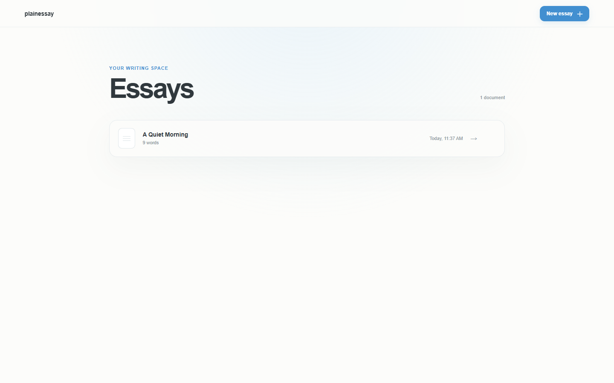
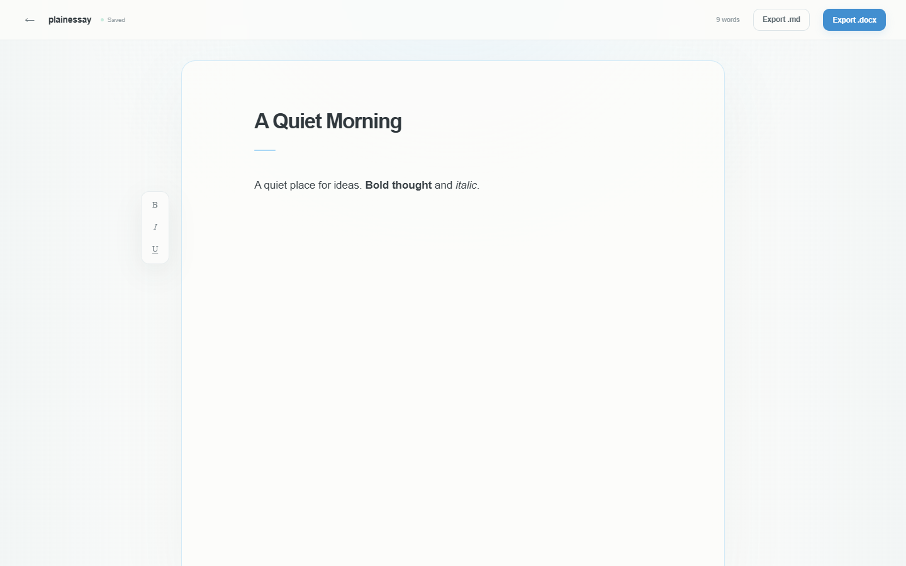

# PlainEssay

A quiet, local-first essay writing app for macOS. PlainEssay keeps a calm library of essays, gives you one distraction-free page to write on, and exports clean Markdown and Word documents.

Built with Tauri 2, React, TypeScript, TipTap, and SQLite. No accounts, no cloud, no telemetry.





## Download

Download the latest universal build for macOS 12 or newer (Apple Silicon and Intel) from [Releases](https://github.com/Phanstal/PlainEssay/releases/latest):

- `PlainEssay_0.1.0_universal.dmg`
- `PlainEssay_0.1.0_universal.zip`
- `SHA256SUMS.txt`

Verify the download before opening it:

```sh
shasum -a 256 -c PlainEssay_0.1.0_universal.dmg.sha256
```

### First launch

The app is **unsigned and not notarized** (personal distribution, no Apple Developer ID). macOS Gatekeeper will warn on first launch:

1. Open the DMG and drag `PlainEssay.app` to `/Applications`.
2. Right-click the app, choose **Open**, then **Open** again. Or use **System Settings → Privacy & Security → Open Anyway**.
3. If macOS says the app is damaged, clear the quarantine flag:

```sh
xattr -dr com.apple.quarantine /Applications/PlainEssay.app
```

Because every build is ad-hoc signed rather than notarized, you may need to repeat this after installing a new release.

## What it does

- **Library**: every essay sorted by last edit, word count, and a friendly “Today, 2:07 AM” timestamp.
- **Writing page**: title, body, and a small floating Bold / Italic / Underline toolbar. No sidebars, counters, or formatting panels in your way.
- **Autosave**: changes save to a local SQLite database after a short debounce, with a visible `Saving…` / `Saved` state.
- **Markdown export**: valid CommonMark. Bold, italic, headings, and paragraphs are converted by Turndown; underline is kept as `<u>` because CommonMark has no underline syntax.
- **Word export**: a `.docx` with a centered title, Times New Roman 12 pt, double line spacing, one-inch margins, and inline bold / italic / underline preserved.
- **Native macOS shell**: overlay title bar, real application menus (`File`, `Edit`, `Format`, `View`, `Window`), `⌘N`, `⌘S`, `⌘B`, `⌘I`, `⌘U`, and window state restoration.
- **Delete**: right-click an essay row, or use the `⋯` button, then confirm.
- **Local only**: the database never leaves the Mac.

## Your data

The SQLite database lives at:

```text
~/Library/Application Support/com.phanstal.plainessay/plainessay.db
```

Back it up with Time Machine or by copying that file while PlainEssay is closed. Removing the app does not remove the database; delete the folder above if you want a clean slate.

Word counts use whitespace-separated tokens for Latin text and count CJK characters individually, so Chinese and Japanese writing gets a useful count instead of “1 word”.

## Development

Prerequisites:

- Node.js 22 or newer
- Rust stable (`rustup`)
- macOS: Xcode Command Line Tools
- Windows: Visual Studio C++ build tools and WebView2
- Linux: the usual Tauri 2 WebKitGTK dependencies

```sh
npm install
npm run dev          # browser mode, localStorage adapter, hot reload
npm run tauri dev    # native window, SQLite adapter
```

Checks:

```sh
npm run lint
npm run typecheck
npm test             # Vitest: domain, storage, Markdown and DOCX
npm run build
npx playwright install chromium
npm run test:e2e     # builds first; starts `npm run preview`
cargo test --manifest-path src-tauri/Cargo.toml
cargo clippy --manifest-path src-tauri/Cargo.toml --all-targets -- -D warnings
```

Build a universal macOS app locally:

```sh
rustup target add aarch64-apple-darwin x86_64-apple-darwin
npm run tauri build -- --target universal-apple-darwin --bundles app
```

The CI workflow runs lint, typecheck, unit tests, production build, and Playwright E2E on Ubuntu, plus Rust formatting, Clippy, and tests on macOS.

## Releasing

Push a tag such as `v0.1.0`. [`.github/workflows/macos.yml`](.github/workflows/macos.yml) builds a universal `.app` on `macos-15`, ad-hoc signs it, creates the DMG and ZIP, writes SHA-256 checksums, and publishes a GitHub Release. There is no Apple signing identity or notarization in this project, so the Gatekeeper instructions above apply to every release.

## Architecture

```text
React views (library, editor)
        │
        ├── domain: Essay, word counting, timestamps, filenames
        ├── infra/storage: EssayRepository
        │     ├── SQLite adapter (Tauri desktop)
        │     └── localStorage adapter (browser + E2E)
        ├── infra/export: Markdown (Turndown) and DOCX (docx)
        └── platform: Tauri detection, native menu command bus, save dialog
        │
Rust shell (src-tauri): plugins, menus, window config, save_export command
```

The storage and export layers are ports with no React dependency. That is what keeps the app portable to a future iOS or Android target without rewriting the writing model or export logic.

Read [docs/architecture.md](docs/architecture.md) for the detailed decisions, data schema, save pipeline, and mobile-porting plan. The design source and frozen reference assets are in [docs/design](docs/design).

## Why Tauri instead of SwiftUI?

The target was a Mac app that can later become an iPhone or Android app. Tauri 2 gives a native window and menus today, a React/TipTap writing experience that runs in WKWebView, and a documented mobile path for later. The trade-off is a WebView-based editor and a Rust toolchain; for this single-window, local-first app that is a good exchange. SwiftUI would be excellent for Mac-only, but would require a second implementation for mobile.

## Privacy

PlainEssay has no network code, no analytics, no account system, and no synchronization. The only file writes outside its own database are exports you explicitly choose in a save dialog.

## Design

The interface is based on the [PlainEssay Figma Make prototype](https://www.figma.com/make/qn6Dlo2r2frD52bPjC1hal/PlainEssay-Writing-App). Figma Make files are not supported by the Figma MCP server, so the prototype's CSS, markup, and reference screenshots were frozen into [docs/design](docs/design) and used as the visual contract. See [docs/design/README.md](docs/design/README.md) for tokens and intentional deviations.
